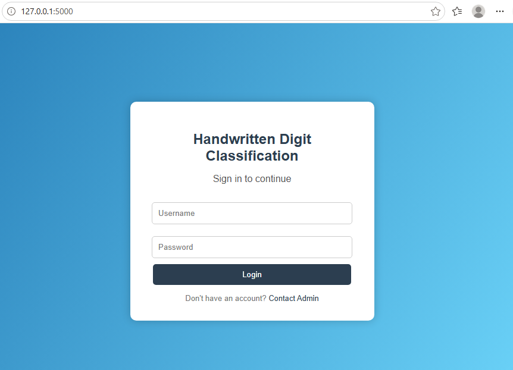
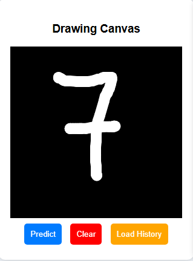
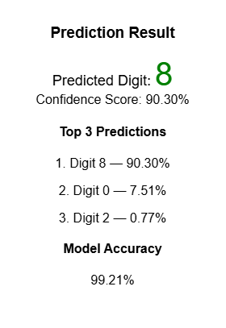
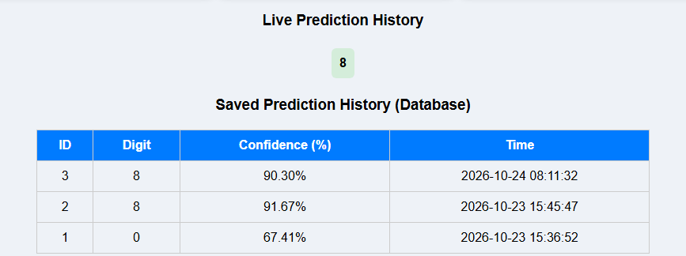

# ✍️ AI Handwritten Digit Recognition System

## Recognizing handwritten digits using Machine Learning and Deep Learning

## 📌 Project Overview

The AI Handwritten Digit Recognition System is a web-based application that recognizes handwritten digits from 0 to 9 using a trained deep learning model.

Users can draw a digit directly on the screen using a mouse or touchpad. The application processes the drawing and predicts the corresponding digit using a Convolutional Neural Network (CNN).

The system provides prediction results, confidence scores, and a user-friendly interface for interactive digit recognition.

## 🎯 Objectives

- Recognize handwritten digits from 0 to 9.
- Provide real-time digit prediction.
- Build an interactive web-based application.
- Display prediction confidence and alternative predictions.
- Store prediction history for future reference.
- Visualize prediction results using charts and analytics.

## ✨ Key Features

- 🔐 **User Authentication:** Login interface for users.
- ✍️ **Interactive Drawing Canvas:** Draw digits using a mouse or touchpad.
- 🤖 **AI-Based Prediction:** Predict handwritten digits using a trained CNN model.
- 📊 **Top-3 Predictions:** Display the three most likely digit predictions, if implemented.
- 🎯 **Confidence Score:** Display the model's confidence in its prediction, if implemented.
- 🔊 **Voice Prediction:** Read the predicted digit aloud, if implemented.
- 🗃️ **Prediction History:** Store previous predictions using SQLite, if implemented.
- 📈 **Analytics Dashboard:** Visualize prediction history and statistics, if implemented.
- 💬 **User Feedback:** Allow users to provide feedback, if implemented.

## 🛠️ Technologies Used

| Technology | Purpose |
|---|---|
| Python | Backend programming |
| Flask | Web application framework |
| TensorFlow / Keras | Deep learning model |
| CNN | Handwritten digit classification |
| NumPy | Numerical operations |
| Pillow (PIL) | Image processing |
| HTML | Web page structure |
| CSS | User interface styling |
| JavaScript | Drawing canvas and frontend interactions |
| SQLite | Database for prediction history |
| Chart.js | Interactive charts, if implemented |

## 🧠 How It Works

1. The user opens the web application.
2. The user draws a digit on the drawing canvas.
3. The application captures the drawing as an image.
4. The image is preprocessed into the format expected by the trained model.
5. The CNN model analyzes the image.
6. The application predicts the most likely digit.
7. The result and confidence score are displayed to the user.
8. Prediction history and analytics are updated when those features are enabled.

## 🏗️ Project Architecture

```text
AI-Handwritten-Digit-Recognition/
│
├── app.py
├── mnist_model.h5
├── train_model.py
├── requirements.txt
│
├── templates/
│   ├── login.html
│   └── index.html
│
├── static/
│   ├── style.css
│   └── script.js
│
├── screenshots
│   ├── login.png
│   └── prediction.png
│   └── top3-predictions.png
│   └── dashboard.png
│
└── README.md
```


## ⚙️ Installation and Setup

### Prerequisites

- Python 3.10 (recommended if compatible with your TensorFlow version)
- pip
- Git

### Step 1: Clone the Repository

```bash
git clone https://github.com/ppriyagowda/Handwritten-digit-classification.git
```

### Step 2: Open the Project Directory

```bash
cd Handwritten-digit-classification
```

### Step 3: Create a Virtual Environment

```bash
python -m venv venv
```

Activate it on Windows:

```bash
venv\Scripts\activate
```

### Step 4: Install Dependencies

```bash
pip install -r requirements.txt
```

### Step 5: Run the Application

```bash
python app.py
```

### Step 6: Open in Your Browser

Visit:

```text
http://127.0.0.1:5000/
```

The application should now be available locally.

## 📊 Model Information

The system uses a Convolutional Neural Network (CNN) for handwritten digit classification.

The model is designed to classify grayscale digit images into ten classes:

**0, 1, 2, 3, 4, 5, 6, 7, 8, 9**

## 📈 Model Performance

- **Model:** Convolutional Neural Network (CNN)
- **Dataset:** MNIST Handwritten Digits
- **Number of Classes:** 10 (Digits 0–9)
- **Test Accuracy:** 99.57%
- **Test Loss :**0.0146
- **Optimizer:** Adam

## 🖥️ Application Screenshots

### 1. Login Page


### 2. Handwritten Digit Prediction


### 3. Top3-Predictions


### 4. Analytics Dashboard


## 🔮 Future Enhancements

- Improve recognition accuracy using additional training and evaluation.
- Support touch-enabled mobile devices.
- Deploy the application to a public hosting platform.
- Add downloadable prediction reports.
- Improve model robustness for different handwriting styles.
- Add comprehensive model evaluation and performance metrics.

## 🎓 Learning Outcomes

Through this project, I explored:

- Machine learning and deep learning concepts.
- CNN-based image classification.
- Image preprocessing and prediction.
- Flask web application development.
- Frontend and backend integration.
- Database integration using SQLite.
- Interactive data visualization.

## 👩‍💻 Author

**Priyanka RM**

BCA Data Science Student

Interested in Machine Learning, Data Science, and Analytics.

---

⭐ If you find this project interesting, consider giving this repository a star!
